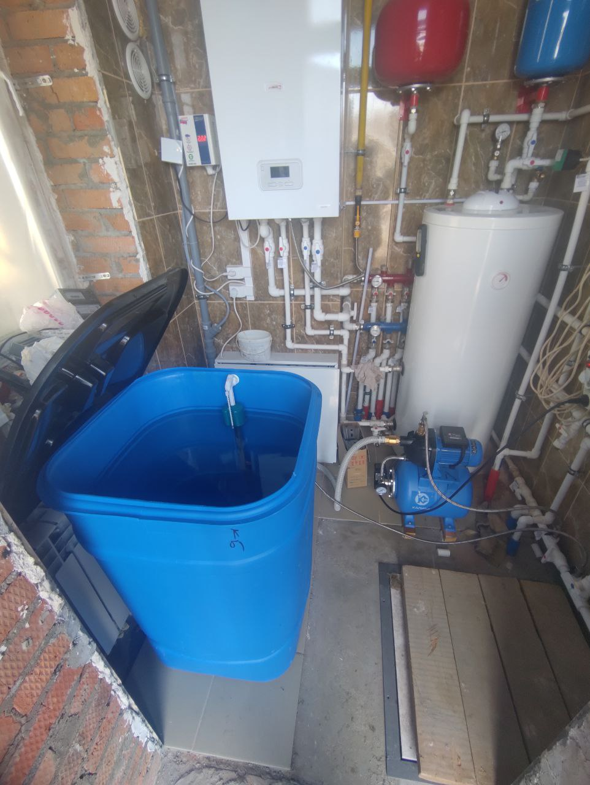
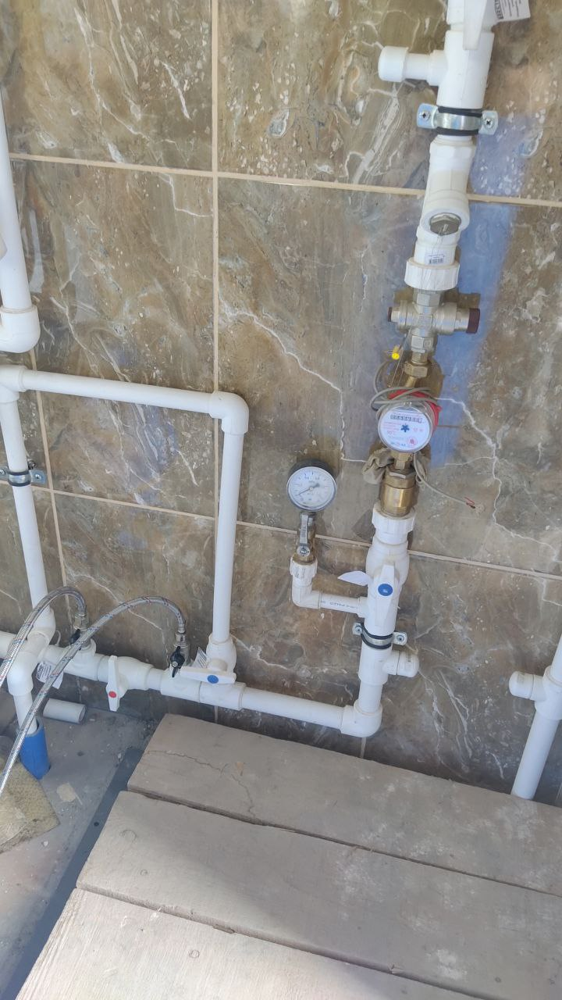
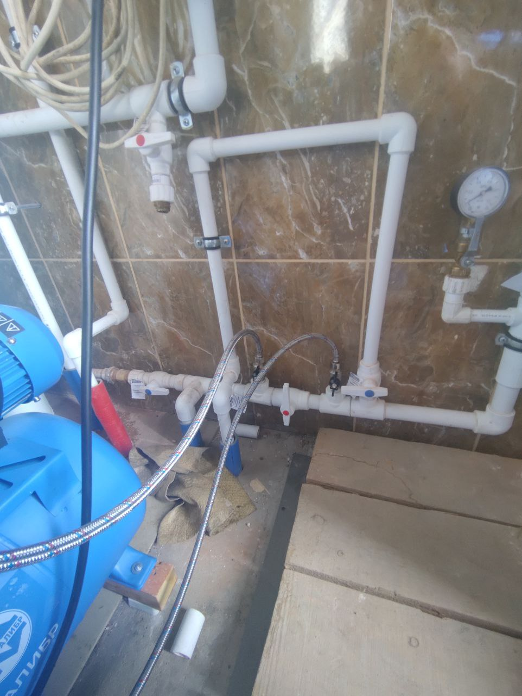
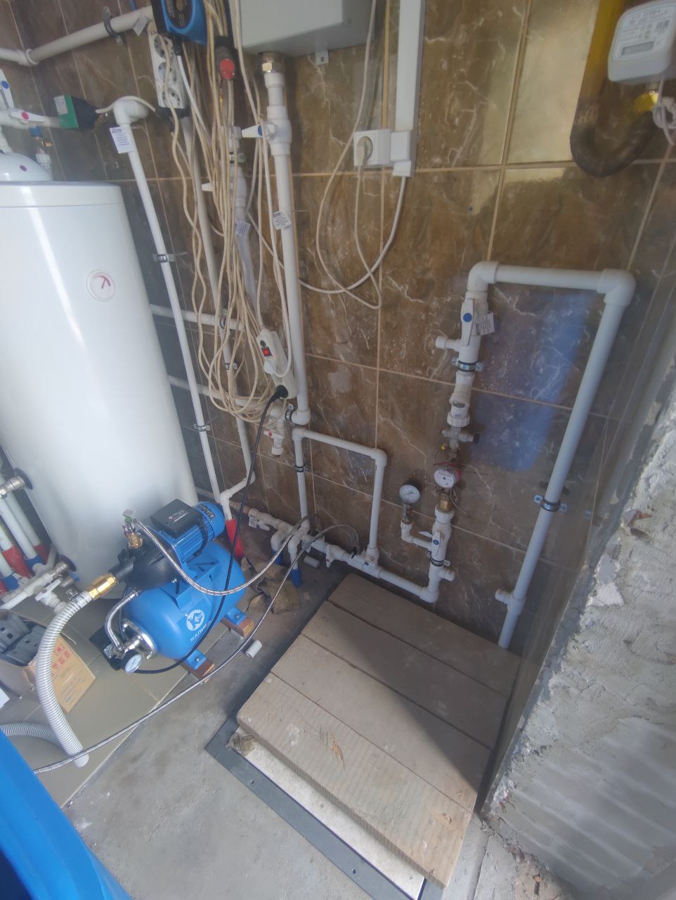

## Комплектующие

- Ëмкость: [Бочка-бак ЗПИ «Альтернатива» 300 л, квадратная, с крышкой М3047](https://www.vseinstrumenti.ru/product/bochka-bak-zpi-alternativa-300-l-kvadratnaya-s-kryshkoj-m3047-10317242/)
- Насосная станция: [Калибр СВД-850П](https://kalibr-online.ru/products/stantsiya-vodosnabzheniya-kalibr-svd-850p--27452.html)
- Трубы: [Шланг садовый напорно-всасывающий морозостойкий Вихрь - 25мм/1"](https://ozon.ru/t/d7q7KdY)

## Фото

Общий вид:

Узел ввода воды:

